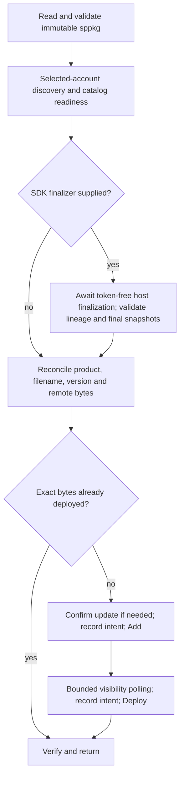

# Publish a standalone SharePoint package

**Status:** Prototype. This page is the behavioral contract for the committed
standalone package operation.
**Domain:** Publish

## Contract

`TeamsAppInputs["sharepoint-package-file"]` is optional. Relative paths resolve
against the project folder. The input is a standalone SPFx `.sppkg`, not a source
configuration or an agent ZIP. Existing `spfx/deploy` YAML configuration remains
compatible; both paths share the operation-scoped SharePoint HTTP client.

Combined publication returns package path and separate SharePoint and agent
states. Failures carry the same partial result. A token-free recovery record
under the project `.local` folder is written before mutations. Recovery reads
remote state and compares downloaded package bytes before skipping an upload.
Unknown agent submission outcomes require operator reconciliation; they are
never automatically retried. The prototype supports same-origin commercial/GCC
SharePoint catalogs; cross-origin/multi-geo catalogs and unsupported publishing
clouds fail closed before mutation.

### Host preparation

An optional `FxCorePublishOptions.prepareSharePointPublish` callback extends the
existing combined operation only. This is the user-approved SDK-only extension
to the existing scenario, not a new CLI feature or product flow.
[ADR-0027](../../../02-architecture/adr/ADR-0027-publish-preparation-boundary.md)
owns the host/engine boundary.

The callback receives a readonly, token-free
`SharePointPublishPreparationContext`: original `projectPath`, verified
`tenantId` and `catalogUrl`, `originalSharePoint` metadata (`packagePath`,
`productId`, `version`, `sha256`, `skipFeatureDeployment`), and optional `signal`.
It returns `Result<PreparedSharePointPublishArtifacts, FxError>` containing
`sharePointPackagePath`, `appPackagePath`, and `lineage`. Paths resolve against
the original project, never a temporary staging project. The host retains
staged files until the SDK promise settles, including cancellation.

`SharePointPublishLineage` contains `schemaVersion: 1`,
`originalSharePointSha256`, `transformationVersion`, `selectedEmbeddedPackage`,
`extractedPluginSha256`, `derivedSharePointSha256`, and `finalAppSha256`.
ATK verifies original/derived/final artifact hashes and original-versus-derived
product, version and deployment policy. The bounded normalized embedded member
path and plugin digest are host-attested provenance, not independent evidence
that ATK extracted or transformed those bytes. ATK accepts no arbitrary
additional lineage fields in its persisted record.

Prepared results/errors include `projectPath` and `lineage`. The same recovery
location under the original project records schema version 2 for prepared
publication; legacy schema version 1 remains readable. Either version's unknown
agent outcome blocks replay. Catalog discovery invokes no finalizer on failure
and performs no journal write, confirmation, upload or deployment. The callback
is awaited exactly once before final agent validation and snapshot freeze.
Failure or cancellation has no fallback to the original artifacts.

## Acceptance Criteria

| ID | Runtime | Purpose | Gate | Harness | Expected result |
|---|---|---|---|---|---|
| SPO-01 | L1 | operation-integration | required | archive/temp directory | Standalone package metadata and SHA-256 come from bounded immutable bytes; malformed, duplicate, unsafe, external-entity or non-client-side archives fail before HTTP. |
| SPO-02 | L1 | operation-integration | required | HTTP adapter | Selected Graph and SPO identities match; root discovery uses configured Graph and JSON Accept; missing grants/catalog or foreign authority fail before writes. |
| SPO-03 | L1 | operation-integration | required | HTTP adapter | Independent clients preserve their own origins; binary Add captures UniqueId separately from product ID, safely escapes filenames, and Deploy uses packaged SkipFeatureDeployment. |
| SPO-04 | L1 | operation-integration | required | HTTP adapter | Bounded polling requires expected version, client-side classification, deployment flags and no package errors. Cancellation and failures prevent continuation. GET throttling is bounded; POSTs are not blindly retried. |
| SPO-05 | L1 | operation-integration | required | HTTP adapter | Same-product update requires confirmation; downgrade and filename/identity collision are refused. Exact downloaded bytes plus verified state permit reuse without upload/deploy. |
| SPO-06 | L1 | operation-integration | required | temp directory/HTTP adapter | Journal preserves independent stage states across failure/retry; ambiguous writes are explicit, no destructive rollback, no repeated ambiguous agent submission. |
| SDK-01 | L1 | compatibility | required | public entry/temp directory | Root and documented lean entry expose the same bounded read-only package inspector and types. Missing, malformed and unsafe inputs work without toolkit resources, auth or network; a caller error factory can provide host-localized messages. |
| SDK-02 | L1 | operation-integration | required | HTTP adapter | An explicit expected tenant GUID is checked against the actual prepared Graph identity before SharePoint preflight, journal creation or writes. Omission preserves existing behavior. |
| SDK-03 | L1 | scenario | required | confirmation fake | Required update confirmations identify the filename, product/manifest ID, target version and planned operation; refusal/noninteractive behavior remains unchanged. |
| SDK-04 | L1 | compatibility | required | manager/file snapshot | Optional expectedSharePointSha256 must be 64 hex characters and match the immutable package snapshot before agent preparation, authentication, remote work or journal writes; stale selector metadata cannot authorize different package bytes. |
| PREP-01 | L1 | operation-integration | required | public SDK/temp directory/HTTP adapter | Original validation and expected digest precede authentication; matching Graph/SPO identity and same-origin catalog discovery precede one token-free finalizer; final validation/hash freeze precede every mutation and journal. |
| PREP-02 | L1 | operation-integration | required | public SDK/temp directory | Malformed/missing callback output or lineage, original change, derived digest/identity/version/deployment-policy mismatch, and final app digest mismatch fail before journal or writes. Host failures never fall back to original packages. |
| PREP-03 | L1 | operation-integration | required | public SDK/HTTP adapter | Changed account/tenant/catalog or changed original/derived/final package after finalization or confirmation prevents mutation; final confirmations and uploads reference only the final snapshots. |
| PREP-04 | L1 | operation-integration | required | public SDK/deferred finalizer | Cancellation awaits finalizer settlement and prevents validation, journal and writes; no callbacks run after pre-cancel or failed discovery. |
| PREP-05 | L1 | scenario | required | public SDK/HTTP adapter/journal | Final hashes and validated allowlisted lineage appear in success/partial error and the original project's sole journal; verified SPO survives Graph rejection/unknown outcome. |
| PREP-06 | L1 | compatibility | required | public SDK/legacy journal | Unknown outcomes from schema 1 or 2 remain fail-closed; same-version different derived bytes and downgrades are still rejected; no callback preserves existing standalone/ordinary behavior. |

## Flow

## Boundary

No catalog creation, Teams synchronization, site installation, API permission
approval, SPFx build, host-specific integration, or automatic rollback. Remote mutation
tests require approval of the exact artifacts and actions.

## Invariants

- Never send Graph tokens to SharePoint, follow token-bearing redirects, infer a
  tenant hostname from an email, or share mutable client origins.
- No archive extraction. Limit package bytes, entry count, expanded total and
  manifest size; reject DTD/entity declarations and ambiguous metadata.
- Product ID, catalog item ID, agent ID, versions and hashes remain distinct.
- Upload success is not deployment success. Version equality is not byte equality.
- Failed/unknown writes remain observable even after cancellation.
- Host extraction/transformation and publication orchestration remain separate;
  the finalizer cannot authorize skipping validation, confirmation or recovery.
- Original input is never compared to sanitized remote bytes. Deployed/result
  hashes refer to the derived snapshot; agent hashes refer to the final ZIP.
