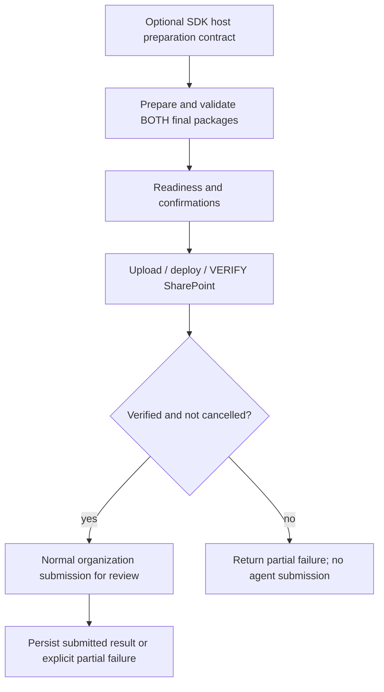

# SharePoint-first organization publication

**Status:** Prototype
**Domain:** Publish
**Scenario ID:** SCN-SPO-PUBLISH
**Workflow:** `atk publish --sharepoint-package-file` and `FxCoreClient.publish`

## Composed operations

- [Standalone SharePoint deployment](../../operations/publishing/sharepoint-package.md)
- Existing agent package preparation/validation and organization-catalog publish
  (`requiresReview=true`), not personal sideload.

## Acceptance Criteria

| ID | Runtime | Purpose | Gate | Harness | Expected result |
|---|---|---|---|---|---|
| PUB-01 | L1 | compatibility | required | command/SDK/manager | No option preserves ordinary inputs, calls, scopes and result shape. |
| PUB-02 | L1 | scenario | required | command/SDK/manager + HTTP | Both package inputs coexist and reach the shared engine. Both packages, known publication prerequisites and confirmations are checked before writes; SharePoint verification precedes the single agent submission. |
| PUB-03 | L1 | scenario | required | manager + HTTP | SharePoint failure/cancellation never submits the agent. Agent failure/cancellation retains verified SharePoint state and identity. |
| PUB-04 | L1 | scenario | required | journal + HTTP | Retry rechecks SharePoint bytes/state without duplicate upload/deploy; unknown agent submission is reconciled/read and blocked for explicit operator review, not blindly repeated. |
| PUB-05 | L2 | surface | required-local | built CLI | Help exposes the independent flag; invalid local input exits unsuccessfully without authentication/mutation. |
| PUB-06 | L2 | CLI-E2E | explicit approval required | selected tenant/artifacts | Real combined submission and approved update/failure recovery. Not claimed by local mocks. |
| PUB-07 | L1 | scenario | required | manager + HTTP + journal | Agent catalog read/submission errors identify the Graph stage and retain bounded, sanitized status, service code/message, request ID and transport code. A definitive submission rejection preserves verified SharePoint and agent `failed`; a timeout remains `unknownOutcome`, is recorded, and cannot cause a blind retry. No raw request, tokens, authentication URLs or response bodies enter diagnostics. |
| PUB-08 | L1 | scenario | required | public SDK + finalizer + HTTP + journal | An in-process host resolves catalog-dependent content before final validation using the preparation contract; the final derived SharePoint bytes are verified before the final agent ZIP is submitted, while lineage and recovery stay anchored to the original project. |

## Flow

## Boundary

No change to ordinary publish requests, scopes or retry policy, or the separate
YAML publish route. Publication error diagnostics may be clarified. No claim of
agent approval, installation or availability. Host-specific adoption is separate.
